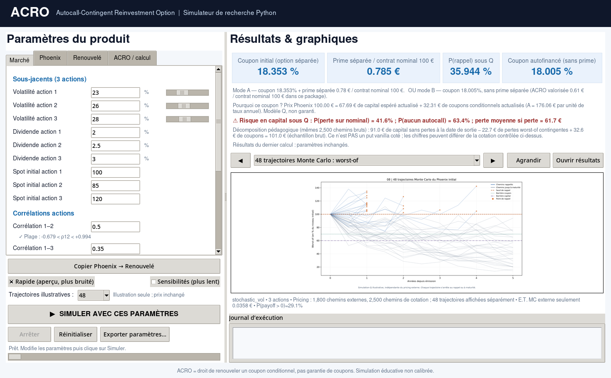
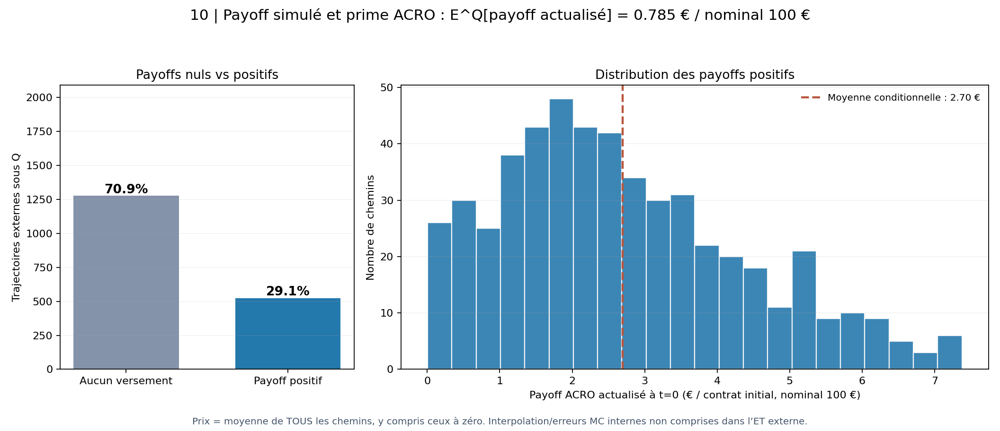

# ACRO — Autocall-Contingent Reinvestment Option

I built ACRO to explore a problem with autocallable structured products: a Phoenix can redeem early, leaving its investor with cash to reinvest, possibly at a much lower conditional coupon than the original note offered.

ACRO is a separate option purchased alongside the initial Phoenix. If that Phoenix autocalls before maturity, ACRO gives the investor the **choice** to subscribe at par to a new Phoenix with the original contractual coupon rate. If the new note would be worth less than the subscription price, the investor can simply let the option expire. The coupon is still conditional; ACRO does not guarantee future payments or protect the investor from losses on the renewed note.

This repository is my Python research prototype for pricing that option and testing how it behaves under different assumptions. It is not a tradable quote or a product offered by a bank.



## The idea in one example

Suppose the original Phoenix autocalls in year two. A new note with the same coupon and contractual terms has a theoretical market value of €107, while ACRO allows subscription at €100. The exercise value is €7. If that new note is worth €97 instead, there is no reason to exercise.

The payoff at an eligible early autocall date is

$$
\max\left(V_{\mathrm{new\ Phoenix}}(\tau)-K,\,0\right),
$$

where $K$ is the agreed subscription price (normally €100 in my examples). Without an eligible autocall, the ACRO payoff is zero.

## What the project does

- **Prices Phoenix notes and ACRO** using risk-neutral Monte Carlo simulations. It estimates the Phoenix coupon that makes the initial note worth par, then prices the separate reinvestment option.
- **Handles different equity baskets:** 1–6 stocks, with worst-of, best-of and equally weighted normalized-basket reference rules. The original case is a three-stock worst-of Phoenix.
- **Lets me change the assumptions** — volatility, dividends, correlations, interest rate, coupon and protection barriers, autocall dates and simulation budgets.
- **Provides a desktop interface** in Python/Tkinter, with payoff distributions, scenarios and sensitivity plots. The headless script writes the same kind of results to a local folder.

The default Phoenix has a five-year maturity, semiannual conditional coupons without memory, annual autocall opportunities in years 1–4, a 70% coupon barrier and a 60% European protection barrier. These are example terms, not an investment recommendation.

## How I price it

The baseline model uses correlated equity paths under the risk-neutral measure, constant interest rates and dividend yields, and a shared stochastic log-volatility factor with mean reversion. It is a deliberately simplified market model.

There are two parts to the calculation. The outer simulation tracks the original Phoenix and identifies eligible autocalls. At each call, the model needs the value of a *new* Phoenix under the market state at that time. Conditional simulations estimate that renewal value, with a reusable grid/interpolation approach to make repeated pricing more practical. The option pays only when the renewal value exceeds its strike.

For a Phoenix whose coupon changes the size of payments but not the observation events, the model separates its value into a principal component and a coupon component, $V=B+cA$. That also makes it possible to solve for the par coupon numerically.

A quick run with the default **synthetic** assumptions gives an annual par coupon around **18.35%** and an ACRO premium around **€0.78 per €100** initial notional. These are illustrative model outputs, **not current market levels**. Results and numerical error depend on the configuration and simulation budget.



## Running it

The project was developed around **Python 3.11 and Spyder**. From the repository directory, in a fresh Python environment:

```bash
python -m pip install -r requirements.txt
python -m pytest -q
python run_demo.py --quick --no-sensitivity --output results_local
python LAUNCH_ACRO_GUI.py
```

The last command opens the desktop interface; it requires Tkinter to be available in your Python installation. You can also open `LAUNCH_ACRO_GUI.py` directly in Spyder and run it there. The demo saves its outputs under `results_local/`, while interface runs are saved under `GUI_RUNS/`. Both are excluded from Git.

`config.json` contains the original three-equity reference configuration. The GUI can modify the basket and contract assumptions without overwriting that file.

The package is organised as follows:

- `acro/` — simulation, product cash flows, pricing and risk-analysis modules
- `acro_gui.py` — desktop interface
- `run_demo.py` — reproducible command-line example
- `tests/` — numerical and regression tests
- `research/` — supplementary experiments and validation scripts
- `notes/` — detailed development notes and methodological checks

## What is still missing

The model has not been calibrated to a live equity volatility surface, dividend curves or market correlation data. It also does not fully model issuer credit risk, funding and distribution costs, or the practical difficulty of hedging an untraded volatility factor. Some numerical errors, particularly those from inner estimation, interpolation and time discretisation, are not captured by the reported outer-path standard error.

I have tested the implementation and studied several sensitivity and convergence cases, but those checks are not a substitute for independent model validation. Development and technical reviews also involved AI assistance. I treat ACRO as a research exercise in structured-product design and pricing, not a production pricer.

The code is shared for educational purposes and is not investment advice.
